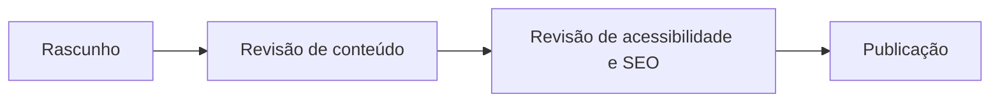

## Texto e citações

Um parágrafo comum, com **ênfase forte**, *ênfase*, `código` e um [link interno](/sobre/). Afirmações de outras fontes levam citação, como "ensinar não é transferir conhecimento" [@freire1996, p. 25]. Dados oficiais também são citados [@inep2024].

Notas de rodapé também funcionam.[^1]

[^1]: Uma nota de rodapé de exemplo.

::callout{type="definition"}
**Linguagem simples** é a escrita que permite ao público encontrar, entender e usar a informação na primeira leitura.
::

## Gráfico

::chart
---
type: bar
title: "Matrículas em duas redes de ensino, 2021 a 2023 (dados fictícios)"
summary: "Nos dados fictícios, a rede A cresce todos os anos e a rede B se mantém estável."
unit: " mil"
labels: [2021, 2022, 2023]
series:
  - name: Rede A
    values: [120, 135, 150]
  - name: Rede B
    values: [90, 92, 91]
source: Dados fictícios para demonstração
---
::

::chart
---
type: line
title: "Taxa de conclusão em duas regiões (dados fictícios)"
summary: "Nos dados fictícios, as duas regiões melhoram, e a distância entre elas diminui."
unit: "%"
labels: [2019, 2020, 2021, 2022]
series:
  - name: Região 1
    values: [62, 65, 70, 74]
  - name: Região 2
    values: [48, 53, 60, 66]
source: Dados fictícios para demonstração
---
::

## Tabela

::data-table{caption="Exemplo de tabela com legenda (dados fictícios)"}
| Etapa | Escolas | Matrículas |
|-------|---------|------------|
| Anos iniciais | 12 | 3.400 |
| Anos finais | 9 | 2.950 |
::

## Imagem com descrição detalhada

::image-figure{src="/media/guia-de-componentes/barras-exemplo.png" width="1280" height="720" kind="infographic" alt="Três barras cinza de alturas crescentes, da esquerda para a direita." caption="Infográfico de exemplo: três barras de alturas diferentes." credit="Imagem gerada para demonstração"}
#description
A imagem mostra três barras verticais lado a lado sobre uma linha de base. A primeira é a mais baixa, a segunda tem altura intermediária e a terceira é a mais alta. As barras não têm rótulos nem valores: servem apenas para testar o componente.
::

## Diagrama

::diagram{alt="Fluxo de revisão de um artigo, do rascunho à publicação." caption="Fluxo de revisão de um artigo."}

#description
1. O artigo começa como rascunho.
2. Passa pela revisão de conteúdo.
3. Passa pela revisão de acessibilidade e SEO.
4. É publicado.
::

## Fórmula

O coeficiente de Gini pode ser escrito como $G = \frac{A}{A + B}$, em que $A$ é a área entre a linha de igualdade e a curva de Lorenz.

$$
G = 1 - \sum_{k=1}^{n} (X_k - X_{k-1})(Y_k + Y_{k-1})
$$

## Código

```ts
const turmas = ['1º ano', '2º ano']
console.log(turmas.length)
```

## Conteúdo incorporado

::external-embed{src="https://www.openstreetmap.org/export/embed.html?bbox=-47.95%2C-15.85%2C-47.80%2C-15.75&layer=mapnik" title="Mapa da região central de Brasília" provider="OpenStreetMap"}
O mapa mostra a região central de Brasília, no Distrito Federal, com o Eixo Monumental e o Lago Paranoá.
::
