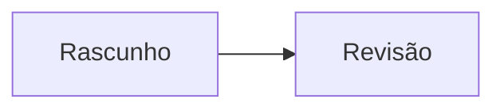

# Writing guide

How to create pages and posts. Read the [content principles](principles/content.md) first.

## Where files go

Each page is a folder with two files that share the folder's name:
- `.md` holds **only the text**, with no front matter.
- `.yml` holds **only the metadata**.

```
content/
├── config.yml                      # site-wide settings and defaults
├── pt-BR/                          # default language: no URL prefix
│   ├── index.md + index.yml        # home page            → /
│   ├── sobre/sobre.md + .yml       # institutional page   → /sobre/
│   └── blog/
│       ├── blog.md + blog.yml      # blog index intro     → /blog/
│       └── andei-20-km/
│           ├── andei-20-km.md      # the post             → /blog/andei-20-km/
│           └── andei-20-km.yml
├── en/                             # → /en/…
└── es/                             # → /es/…
```

The folder name is the URL slug, so write it in the page's language. Use lowercase letters, digits and hyphens only, with no accents. The build checks this.

Images go in `public/media/<post-slug>/` and are referenced as `/media/<post-slug>/file.png`.
- Charts and diagrams: use `::chart` or Mermaid, or an `.svg` file.
- Photos: a JPEG (screenshots: PNG) **at least 1280 px wide**. The build makes the smaller AVIF and WebP versions.
- Always give the real `width` and `height`.

The reasons are in [coding principles, Images](principles/coding.md#7-images).

## Page metadata (`.yml`)

```yaml
title: Sobre                      # the page's h1 and <title>
description: Quem escreve este blog e como as pesquisas são produzidas e revisadas.   # 50–160 characters
translationKey: about             # same value on every language version of this page
draft: false                      # true keeps it out of production builds
noindex: false                    # true: published but hidden from search engines
image: { src: /media/sobre/foto.jpg, alt: Retrato do autor, width: 1200, height: 630 }   # optional, for social sharing (1200 × 630 recommended)
```

## Post metadata (`.yml`)

Everything above, plus:

```yaml
datePublished: 2027-02-10
dateModified: 2027-03-02          # only after a material change
authors:                          # default comes from content/config.yml
  - name: Henrique Freitas Souza
    orcid: 0000-0000-0000-0000
tags: [Avaliação educacional, Ensino médio]
abstract: Um parágrafo acadêmico com objetivo, método, resultados e conclusão.
plainLanguageSummary: Duas a quatro frases simples para quem não é especialista.
citationStyle: abnt               # or apa; default from content/config.yml
references:                       # CSL-YAML; one entry per cited work
  - id: freire1996
    type: book
    title: "Pedagogia da autonomia: saberes necessários à prática educativa"
    author:
      - { family: Freire, given: Paulo }
    issued: { date-parts: [[1996]] }
    publisher: Paz e Terra
    publisher-place: São Paulo
  - id: inep2024
    type: report
    title: "Censo Escolar da Educação Básica 2023: resumo técnico"
    author:
      - literal: INSTITUTO NACIONAL DE ESTUDOS E PESQUISAS EDUCACIONAIS ANÍSIO TEIXEIRA
    issued: { date-parts: [[2024]] }
    publisher: Inep
    publisher-place: Brasília
    URL: https://www.gov.br/inep/
    accessed: { date-parts: [[2027, 2, 1]] }
```

Common CSL types: `article-journal` (needs `container-title`, `volume`, `issue`, `page`, `DOI`), `book`, `chapter` (needs `container-title`, `editor`), `report`, `thesis` (needs `genre`, `publisher`), `webpage`, `article-newspaper`. Zotero can export CSL-JSON, which converts directly to this YAML.

## Writing the text (`.md`)

- **No `#` headings.** The title is the `h1`, so start sections at `##`.
- **Citations:** `[@freire1996]`, `[@freire1996, p. 25]`, `[@freire1996; @inep2024]`.
- **Footnotes:** `text[^1]`, and then `[^1]: The note.` at the end.
- **Another language inline:** `[school choice]{lang="en"}`.
- **Math:** inline `$G = \frac{A}{A+B}$`, or a block between `$$` lines. It renders as MathML, which screen readers read.

## Rich components

Every component below requires its accessible alternatives. The build fails if one is missing (see [accessibility principles](principles/accessibility.md#rich-media-alternatives-three-layers)).

### Image with caption

```md
::image-figure{src="/media/post/grafico.png" width="1280" height="720" kind="infographic" alt="Short alternative." caption="Visible caption." credit="Inep, 2024"}
#description
Full text version of everything the image shows.
::
```

`kind` is `photo` (default), `infographic`, `diagram`, `complex` or `decorative` (then `alt=""`, and no caption is needed). `#description` is required for infographic, diagram and complex images.

### Chart

```md
::chart
---
type: bar                 # or line
title: Matrículas por rede, 2021–2023
summary: A rede municipal cresce todos os anos; a estadual fica estável.
unit: " mil"
labels: [2021, 2022, 2023]
series:
  - name: Municipal
    values: [120, 135, 150]
  - name: Estadual
    values: [90, 92, 91]
source: Inep, Censo Escolar (2024)
---
::
```

The chart is drawn at build time. It comes with a data table and a CSV download.

### Table

```md
::data-table{caption="Escolas por etapa, 2023"}
| Etapa | Escolas |
|-------|---------|
| Anos iniciais | 12 |
::
```

Every markdown table must be wrapped like this, because markdown tables have no caption.

### Diagram (Mermaid)

````md
::diagram{alt="Short alternative." caption="Visible caption."}

#description
1. Text version of the diagram, step by step.
::
````

### Embedded content (video, map, slides)

```md
::external-embed{src="https://www.youtube-nocookie.com/embed/ID" title="What the video is" provider="YouTube"}
A summary or full transcript of the embedded content.
::
```

Nothing loads from the provider until the reader presses the button.

### Callout

```md
::callout{type="definition"}
**Term** is …
::
```

`type` is `note`, `warning` or `definition`.

## Translations

1. Create the page in the other language's folder, with a slug in that language: `content/en/blog/i-walked-20-km/`.
2. Give both `.yml` files the same `translationKey`.

The language switcher, `hreflang` tags and sitemap then link the versions. A page without a version in some language sends readers to that language's home page, and says so.

## Previewing

```bash
pnpm dev
```

The site opens at http://localhost:3000. Drafts are hidden there too; to see them, run:

```bash
INCLUDE_DRAFTS=1 pnpm dev
```

Before opening a pull request, run:

```bash
pnpm check
```
